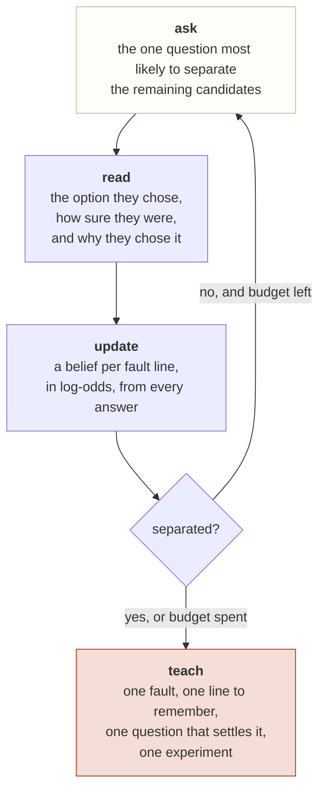

# Faultline

**Every wrong answer has a reason. Faultline finds the exact one.**

[](https://github.com/radhika-verma06/faultline/actions/workflows/ci.yml)
[](https://github.com/radhika-verma06/faultline/actions/workflows/pages.yml)
[](LICENSE)


-8d8577)

| | |
|---|---|
| **Live demo** | https://radhika-verma06.github.io/faultline/ |
| **Docs** | [architecture](docs/architecture.md) · [verification](docs/verification.md) · [data model](docs/data-model.md) · [go to market](docs/gtm.md) · [ADRs](docs/adr/) |
| **Track** | Hyper-Personalized EdTech |

🏆 **Winner — Evorozen Ecosystem Scaling Partnership** at [Evorozen Apex: NextGen AI Buildathon](https://evorozen-apex.devpost.com/)
(Jul 17 – Sep 30, 2026 · online · public · 416 participants · 2 non-cash prizes).

Runs with no API key, no account and no server. Connect an Evorozen Neural Pulse key and the same
build upgrades to live reasoning reads and a persistent cognitive memory.

### Why it is needed

A score says whether an answer was right; it rarely tells a learner or teacher *why* it was wrong.
The same option can reflect different mental models, and each calls for a different explanation.
Faultline uses a short adaptive sequence to distinguish those possibilities, then gives a focused
learning step instead of another score.

### Who should use it

Physics learners exploring mechanics and the teachers or tutors supporting them. Use Faultline as a
**formative learning aid** to surface a possible misconception and decide what to explore next. It is
not a grade, a validated assessment, a diagnosis, or a replacement for a teacher.

### AI in 2026: useful, bounded, and optional

Faultline is not an autonomous tutor or a chatbot asked to decide what a student believes. A
transparent Bayesian engine selects questions and updates the fault map. With no key, the built-in
phrase reader and authored lessons work locally. If a learner connects Neural Pulse, their written
reasoning is sent to that service for bounded evidence and lesson framing; it cannot select the final
fault or invent the authored cue, question, or experiment. Connected mode also syncs profile data.
Avoid entering names or sensitive details into free-text reasoning.

---

## 1. The problem: two students, one wrong answer

A quiz reports a score. A score cannot see the thing that matters.

```
   Student A picks C ──┐
                       ├── same wrong answer, same red cross, same score
   Student B picks C ──┘
                       │
                       ├─ A believes a moving object is still being pushed
                       └─ B believes the force of the throw is stored in the ball
```

These are **different faults**, and they do not have the same fix. Correct A with "friction is what
stopped it" and you have said nothing to B, who was never thinking about friction. Correct B with
"nothing is carried" and A is untouched.

Every adaptive platform on the market personalises the *difficulty* of the next question. Almost
none of them personalise the *diagnosis*: they locate the student on a scale from weak to strong and
teach to the score. That is a one-dimensional answer to a twenty-dimensional problem, and a student
who is strong everywhere except one foundational fault sits near the top of the scale and gets
nothing.

---

## 2. What Faultline does

Three things, in order, and the order is the product.



1. **Ask adaptively.** The next question is chosen to maximise the expected reduction in uncertainty
   over the fault lines, not because it is the next one on a list. No two students see the same
   sequence, and a diagnosis usually lands inside twelve items.
2. **Read the reason, not just the answer.** The student says why in their own words. That sentence
   is what separates two faults that produce an identical wrong answer — the single most valuable
   signal in the whole system, and the one a multiple-choice quiz throws away.
3. **Teach only that.** One fault, with a line to remember, the one question that settles it, and a
   two-minute experiment using what is already in the room.

The output is a **misconception map**: all twenty fault lines, each marked live, suspected, ruled
out, or not yet asked.

---

## 3. The engine, and what the model is not allowed to do

### It is not a chatbot

There is no "ask the AI about physics" box. The intelligence is not a conversational veneer over a
questionnaire — it decides *which question to ask next*, which is why the product cannot be reduced
to a static quiz with a text field bolted on.

**Belief state.** One probability per fault line, updated additively in log-odds, so two independent
tells compose and a weight means the same thing regardless of the student's prior. Deliberately not a
learned model: with twenty-five authored items and no cohort to fit, a trained weight would be a
confident guess dressed as a measurement.

**Question choice.** Bayesian experimental design in the small. Name the hypotheses (every fault
line, plus "none of these"); for each, predict how a student holding it would answer each candidate
item; score each candidate by the mutual information between its answer and the hypothesis, **plus**
what it would let the engine see for the first time. That second term is load-bearing: information
gain alone prefers items that discriminate many faults at once, so an item that tests one fault is
never asked, and that fault sits at the base rate looking exactly like a fault that has been ruled
out. The response model under it is a softmax over per-option affinity, and it is documented as a
simplification rather than presented as a measurement.

**Stopping.** A fault is called live above 82% **and** only when it leads the next candidate by 25
points. A confident wrong diagnosis is worse than an honest "still not sure", so the engine keeps
asking rather than guessing — and it does not close the map while an unasked question carries a tell
strong enough to lift a rival past the leader. If a session could end on the wrong fault, it does not
end yet.

### What the AI layer actually does

Two jobs, and neither of them is physics.

| | |
|---|---|
| **Scores** the student's own words | Which of the twenty faults does this sentence give evidence for or against? Returns signed weights and one short clause, shown directly to the student. |
| **Rewrites** the authored lesson | Takes the fault's authored correction and puts the framing into the student's own words, using what they actually wrote. |

### What it is not allowed to do

These are enforced in code, not requested in a prompt. A prompt is a request; this is a guarantee.

- **It cannot name a fault.** It returns evidence weights. The engine decides the diagnosis. An id
  that is not in the knowledge base is dropped on the way in, so a hallucinated fault can never
  appear on a student's map.
- **It cannot reach certainty.** Every weight is clamped, so no single confident sentence can
  saturate a belief. Beliefs are also clamped strictly inside `(0, 1)` on every update, so no amount
  of stacked evidence makes a belief unrevisable.
- **It cannot invent the teaching.** The line to remember, the question that settles it and the
  experiment come from an authored bank and are passed through verbatim, whatever the model returns.
  Only the framing around them is generated.
- **It cannot fail the session.** Every call is wrapped. A timeout, a rate limit or an unparsable
  response degrades one answer to the built-in phrase reader; it never ends a diagnosis in progress.

---

## 4. The memory layer: Evorozen Neural Pulse

Faultline's central promise is that a fault found in September is still on the map in October. That
requires persistence, and persistence normally means a backend.

The **Neural Pulse API is a virtual database**: one endpoint, `action_type`-discriminated, schemas
declared in plain English and registered into LivingDNA. It is what lets this application keep
per-student fault profiles across sessions without a server, a migration, or a table definition
written by hand.

```
POST https://pulse.evorozen.com/api/neural        Authorization: Bearer <key>

create_schema   fault_profiles, sessions          declared once, on first use
select_data     the student's live belief state   read at the start of every session
update / insert the profile, after each session   upserted by hand: find, then update or insert
chat            "which faults are common in my 8B class this week?"
```

Two properties of that kernel are load-bearing rather than decorative:

- **The AISecurityModule redacts PII before a prompt reaches the LLM.** This product asks
  thirteen-year-olds to explain their reasoning in their own words and then sends that text to a
  model. Redaction is not a feature we wanted; it is a requirement we would otherwise have had to
  build ourselves, and it runs at `CRITICAL_SECURITY` before any other module.
- **No backend means no backend to be down.** The deployed build has no server at all.

**It is an upgrade, not a dependency.** With no key, the app runs the built-in phrase reader
(`src/lib/ai/lexicon.ts`, labelled as a lexicon everywhere it surfaces), the authored lessons, and
local storage. The deployed demo ships with no key on purpose: a secret inlined into a public bundle
is readable by anyone who opens the page, so the key is supplied at runtime and kept in the
student's browser. See [`docs/adr/0006`](docs/adr/0006-no-key-in-the-public-bundle.md).

---

## 5. What is actually checked in this repository

The claims above are enforced by code that runs, not by copy that describes it.

```bash
npm run verify     # lint → typecheck → 82 tests → build
```

- **`npm run lint`** (eslint) and **`npm run typecheck`** (`tsc --noEmit`) are clean.
- **`npm test`** is **82 tests**: 72 unit tests in plain Node with no DOM and no network, and 10 flow
  tests in jsdom that drive the real interface.
- The **unit tests** cover the belief arithmetic, the response model, the selector and the session,
  plus the invariants that matter: every one of the twenty fault lines is *reachable* by a simulated
  student who holds it; no fault is left without a question that could show it; no session closes
  while a remaining question could change the answer; every weight points at a fault that exists;
  every item has exactly one true option; the true option is the model's most likely answer for every
  item under the prior; no item repeats; the same answers always produce the same diagnosis.
- The **flow tests** prove the wiring the unit tests cannot see: that a name and a press of Return
  actually starts a diagnosis, that an answer cannot be sent before an option is chosen, that the
  sequence advances, and that a full session arrives at a report carrying a map. A handler that never
  fires and a screen that never advances are invisible to the engine's own tests, which is how the
  Return-key dead end survived until a student hit it.
- **`npm run smoke`** drives the running app in a real browser and checks the one thing none of the
  other suites can: that the page **hydrates**. Next serves its client runtime from dev-only resources
  and refuses them to hosts it does not recognise, so a page can arrive looking completely finished
  with no handlers attached to anything — no error, no console warning, nothing that works. That is
  exactly how the start screen shipped dead, and the smoke test walks from a typed name to a report on
  both `127.0.0.1` and `localhost` to stop it returning. It needs a browser once: `npm run smoke:install`.
- **`npm run build`** is clean, and a second CI job builds the same app as a static export for
  GitHub Pages, so the deployed path is verified on pull requests rather than on the push that
  publishes.

Which check enforces which claim is tabulated in [`docs/verification.md`](docs/verification.md),
including the things that are deliberately **not** covered.

---

## 6. Run it locally

```bash
npm install
npm run demo     # production build, then serves on http://127.0.0.1:3311
```

| Local URL | |
|---|---|
| http://127.0.0.1:3311 | the diagnosis |

Both loopback names work. Use whichever you like — `127.0.0.1` and `localhost` are different origins,
and the app is configured so that neither is served an inert page.

| Script | |
|---|---|
| `npm test` | all 82 tests (add `test:watch` to keep them running) |
| `npm run typecheck` | `tsc --noEmit` |
| `npm run verify` | lint → typecheck → tests → build |
| `npm run smoke:install` | downloads the one browser the smoke test drives (once) |
| `npm run smoke` | drives the running app in a real browser: hydration, then a full session |

Optionally, set `NEXT_PUBLIC_EVOROZEN_API_KEY` in `.env.local` before `npm run demo` to run the live
layer locally. Do not build the public site with it set.

---

## 7. What is in this repository

```
src/
  app/
    page.tsx            start → question → report: the whole state machine
    layout.tsx          metadata and the shared card
    globals.css         the design tokens, and why they are these
    flow.test.tsx       the interface driven for real, in jsdom: 7 tests
  lib/
    domain/
      misconceptions.ts the twenty faults: the belief, the correction, why it tempts, what it breaks
      items.ts          twenty-five items, every option carrying signed evidence weights
      remediation.ts    per fault: the line to remember, the settling question, the experiment
      *.test.ts         16 tests
    engine/
      belief.ts         log-odds, clamping, the belief state
      select.ts         the response model and information-gain question choice
      session.ts        the session, the diagnosis, the map
      *.test.ts         33 tests
    ai/
      types.ts          the intelligence and memory seams
      lexicon.ts        the built-in phrase reader
      offline.ts        everything that works with no service
      evorozen.ts       the Neural Pulse client, and the gate in front of a model
      index.ts          layer resolution and graceful degradation
      *.test.ts         23 tests
  components/
    Session.tsx         start screen, question card, the live belief rail
    Report.tsx          the diagnosis, the lesson, the map, the evidence trail
    Masthead.tsx        the mark, and the honest provenance note
    ui.tsx              primitives; a state's colour is defined once, so a colour
                        means the same thing everywhere it appears
docs/
  architecture.md       how it is built, and what is deliberately absent
  verification.md       which check enforces which claim
  data-model.md         the tables, and what lives where
  gtm.md                the go-to-market plan
  adr/                  seven decisions worth defending
.github/workflows/
  ci.yml                lint · types · unit and flow tests · a real browser · the Pages export
  pages.yml             the deploy
scripts/
  smoke.mjs             the browser smoke test: does the page hydrate, can a student get through it
  install-browser.mjs   puts that browser in .pw-browsers/, inside the project
```

Rounding it out: `LICENSE` (MIT), `CONTRIBUTING.md`, `SECURITY.md`, `CHANGELOG.md`, issue and pull
request templates, `CODEOWNERS`, and `dependabot.yml`.

---

## 8. The twenty fault lines

Authored in the tradition of the force-concept research that began with the Force Concept Inventory
(Hestenes, Wells & Swackhamer, 1992) and the inventories that followed. **No item or distractor from
that instrument is reproduced**: it is copyrighted, and a diagnostic stops working the moment
students can look up what each wrong answer means. Every stem and option here is written for this
project.

| Severity | Fault lines |
|---|---|
| **Foundational** — everything built on them is affected | motion implies force · force sets the speed · heavier falls faster · at rest means no force · gravity only pulls downward · third-law pairs cancel · the throw is stored in the ball · energy gets used up |
| **Consequential** | zero speed means zero force · circular motion needs an outward force · distance is displacement · friction only slows things down · acceleration means speeding up · effort is work · vectors add like numbers · equilibrium means stopped · gravity stops above the sky |
| **Localised** | mass and weight are the same · constant speed means no forces · "force" and "energy" mean the same thing |

Each is written with the sentence a student actually says, the precise belief, the correction, **why
the intuition is reasonable**, and the later topics it breaks. A test asserts that no entry ever
calls the student careless, silly or stupid — because every one of these is a reasonable inference
from ordinary experience, and a diagnosis a student feels accused by is a diagnosis they will not
act on.

---

## 9. Go to market

The full plan is in [`docs/gtm.md`](docs/gtm.md). The short version:

**The wedge is a shareable artifact, not a paid tier.** The misconception map is the growth loop.
Students screenshot it and send it to each other the same way they send quiz results, because finding
out *exactly* what you have wrong is more interesting than finding out you scored 70%.

| Stage | Motion | What it proves |
|---|---|---|
| **0 → 20 users** | One class, one lesson, introduced by the teacher. The map is the reward. | The diagnosis is worth the twelve minutes. |
| **20 → 200** | Cohort view: a teacher sees which faults are common in their class, and teaches to the distribution instead of to the average. | It saves a teacher time, which is what makes it bought rather than tried. |
| **200 → 2,000** | Departments adopt per topic at the start of a unit, as a pre-test that outputs a lesson rather than a score. | It fits an existing ritual instead of asking for a new one. |

**The wedge topic is mechanics,** because it is where the misconception research is deepest, it is
taught to every student in the world, and the faults underneath it are the ones that wreck everything
downstream.

**What we are not doing:** no district sales, no content library, no gamification. Each of those
replaces the thing that makes this work — a diagnosis specific enough to act on — with something
that is easier to sell.

---

## 10. Reading further

- **Reviewing rather than running?** [`docs/architecture.md`](docs/architecture.md) covers the build
  and lists what is deliberately absent; [`docs/verification.md`](docs/verification.md) maps every
  claim above to the check that recomputes it.
- **The decisions worth arguing about** are in [`docs/adr/`](docs/adr/), including the deadlock that
  shaped the selector and why the fault space is never narrowed.

Built by **Radhika Verma**.
